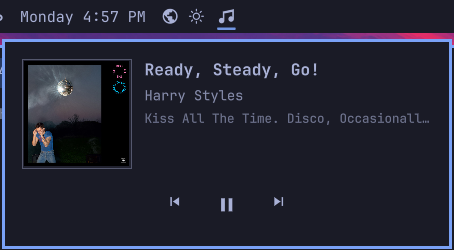
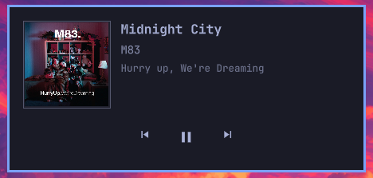

<div align="center">

# Omarchy Audio Control

**A minimal music button for the Omarchy bar.**

Album art, track details, and playback controls, right where you need them.

[Install](#installation) · [Features](#features) · [Usage](#usage) · [Development](#development)

</div>



Omarchy Audio Control keeps your bar uncluttered: a single music-note button opens a compact player when you need it. The popup follows Omarchy's native colors, typography, spacing, borders, and behavior, so it feels at home with your theme.

## Features

- **Minimal by design** — one small bar button, with controls tucked into a popup.
- **Now playing** — see album art, track name, artist, and album at a glance.
- **Playback controls** — play or pause, skip forward, and go back or restart a track.
- **Multiple players** — choose a source when more than one player is available.
- **Native integration** — retains Omarchy's media hotkeys and player detection.

*The popup follows your Omarchy theme; available controls depend on your player.*

## Installation

You need an Omarchy version with the Quickshell shell and `omarchy plugin` commands. Your player must expose MPRIS metadata and controls, as Spotify and many Linux media players do. No additional packages or install scripts are required.

```bash
omarchy plugin add https://github.com/wfoyt/Omarchy-Audio-Control.git --enable
```

Choose your preferred bar section when prompted.

The root manifest registers `wfo.media`, a clone of the built-in `omarchy.media` service. Enabling it replaces the stock media plugin while preserving Omarchy's media hotkeys and player detection.

> **Already have a local `wfo.media` plugin?** Move its folder outside `~/.config/omarchy/plugins/` before installing. The installer refuses duplicate plugin IDs; keep the old folder as a backup.

## Usage



*Your music at a glance, with playback controls just below.*

- Click the music-note button to open or close the popup. Click outside it or press **Escape** to dismiss it.
- Use **Previous / restart** to restart a track after three seconds, or go to the previous track near the beginning. Players without seeking use their native Previous action.
- Use **Play / pause** and **Next** to control the displayed player.
- Select a player from the source picker when multiple players are available.
- When artwork is missing, a music note takes its place. Unavailable controls are dimmed.

## Update or disable

To update the plugin:

```bash
omarchy plugin update wfo.media
```

To disable it without removing its files:

```bash
omarchy plugin disable wfo.media
```

## Removal

To uninstall the plugin, run the following command and confirm the prompt:

```bash
omarchy plugin remove wfo.media
```

For a Git-installed plugin, this deletes its installed directory. If the plugin was enabled, Omarchy restores the built-in media plugin. If needed, you can enable it manually:

```bash
omarchy plugin enable omarchy.media
```

## Development

```bash
omarchy plugin validate .
qmllint MusicWidget.qml Playback.js
```

`MusicWidget.qml` implements the button and popup; `Playback.js` implements previous/restart. `Service.qml` and `MediaModel.js` are derived from [Omarchy's media plugin](https://github.com/basecamp/omarchy), preserving its source selection and playback integration. The `omarchy.clonedFrom` manifest field retains the required service compatibility.

Plugin metadata and entry points are at the repository root so Omarchy's standard Git installer can validate and load the checkout directly.

## License

MIT. See [LICENSE](LICENSE). The media service and model include code derived from Omarchy, copyright David Heinemeier Hansson.
